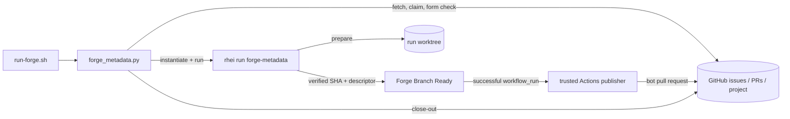

# AR-forge-architecture: Forge architecture

This document describes the high-level implementation shape of Forge:
which component owns each phase of the issue resolution defined in
§FS-forge-issue-resolution-goal, where extensibility lives, and which
boundaries keep generated work reviewable. The behavior Forge must satisfy is
defined by §FS-forge-functional-spec; this file records the implementation
structure chosen to satisfy it, with the workflow catalog in
§FS-forge-workflow-spec-catalog as the behavior surface.

## 1. Architecture Map

| ID | Concern |
| --- | --- |
| §AR-forge-workflow-pipeline | the Rhei state machine of one issue run, state by state |
| §AR-forge-workflow-prompts | the fixed instructions and handoffs every agent state receives |
| §AR-forge-run-location | how progress output and failure output share one phase/step vocabulary |
| §AR-forge-control-plane | how the launcher, GitHub queues, and Rhei workspaces compose |
| §AR-forge-workflow-boundary | how programs turn a claimed issue into an isolated run |
| §AR-forge-strategy-agent-boundary | why programs decide and agents only edit |
| §AR-forge-verification-publication-boundary | why PR creation is a publication step after verification, not part of generation |

## AR-forge-run-location: One run location for progress and failure

The launcher's claim phase names its steps through
`utility_scripts/run_location.py`, the single location vocabulary, so progress
output and failure output cannot disagree about what a phase or a step is
called (§FS-forge-run-location-reporting). A Rhei run names its own location:
the state it is in (§AR-forge-workflow-pipeline).

**One table, no parallel enum.** `run_location` declares the phases and the
phase-to-steps table itself. `claim` is the launcher's; the other phases are
entered by the native trace gate, local CI verification, and branch publication
that the code coverage workflow still runs. The table is the only place a step
name is written, which is what makes `(<n>/<total>)` derivable rather than
hand-counted, and makes an unregistered step name a hard error at the step
boundary instead of a wrong label in a log. A step name may appear under several
phases, because more than one phase runs `generate_tests()` and
`native_trace_gate()`.

**Steps are marked, not narrated.** A step is entered through the `run_step()`
context manager — or the `pipeline_step()` decorator, which is the same thing
applied to a whole function. Entering pushes the location onto a run-local
stack; leaving pops it. A compact phase prints its normal start and outcome
through `log_step_progress()`, which derives `(n/total)` from the same table,
while the method-style entry line is verbose narration. Nothing at a raise site
mentions a step name, because a raise site does not know which step it is in.
The decorator resolves its operand from the call's arguments **by parameter
name**, binding the wrapped signature rather than indexing `args`, so a keyword
call and a positional call of the same function locate identically.

The state is thread-local, so two runs in one process never read each other's
location, and `bind_run_context()` names the run so interleaved banners say
which run they belong to.

**Failures propagate their location, they do not format it.** `run_step()`
annotates a propagating exception with the location it was raised in and
re-raises the original exception object. Annotating rather than wrapping is
required: callers classify external failures by exception type
(§FS-human-intervention-policy), and a wrapper would erase that type. The
annotation is written once by the innermost step and never overwritten, so a
location survives every intermediate `except` on the way out. A `KeyboardInterrupt`
travels unmarked: an interrupt is not a run failure.

Status-code failures — the paths that return a failure status rather than
raise — call `record_step_failure()` instead. Both routes write to the same
run-local failure slot, so the boundary reads one location regardless of how
the failure travelled.

**An unlocated failure is loud.** When a boundary reports a failure that no
step claimed, it reports the step as `<unlocated-step>` and prints a defect
notice: a code path raising outside the step boundaries is a bug in Forge, and
the report says so rather than quietly omitting the step.

**The line is printed once.** A run has one terminal failure, and it may pass
several boundaries on the way out. The reporter is idempotent for the run, so
the boundary nearest the error owns the line and the rest add nothing.

**Verbose narration is separate from failure output.** `stage_logger` owns the
process-wide verbose level, enabled by `--verbose`/`FORGE_VERBOSE`; the older
`FORGE_DEBUG_LOGGING` switch remains an alias. Normal detail follows the phase
most recently announced by `enter_phase()`, rather than the outer Python call
stack. Git commands capture their output and replay it only on failure or under
verbose output, so the default failed-run output is the location and the error
(§FS-forge-run-location-reporting.4, §FS-forge-run-output-legibility.5).

## AR-forge-control-plane: The launcher owns queue control

Forge is a small control plane around one Rhei template, serving
§FS-forge-issue-resolution-goal. `run-forge.sh` loops until stopped; each cycle
checks the host (§FS-forge-requirements) and runs `forge_metadata.py` once,
which fetches the queues, claims one issue, checks its form, and starts the `forge-metadata` workspace
(§AR-forge-workflow-pipeline.1). The claim, the board status, and the close-out
stay in the dispatcher's GitHub helpers; every decision about the issue itself
is made inside the run. The run pushes one verified branch and descriptor, and
repository Actions hand the exact SHA to trusted default-branch publisher code
(§AR-actions-publication), which owns PR creation and publication-related
GitHub mutations.

Issue work is routed by issue label, not by PR label, and the three `fails-*`
labels share one route:

| Issue label | Route in `prepare` | Successful PR label |
| --- | --- | --- |
| `library-new-request` | scaffold, explore | `library-new-request` |
| `library-update-request` | add the version, repair, explore | `library-update-request` |
| `fails-javac-compile` | add the version, repair, explore | `fixes-javac-fail` |
| `fails-java-run` | add the version, repair, explore | `fixes-java-run-fail` |
| `fails-native-image-run` | add the version, repair, explore | `fixes-native-image-run-fail` |

## AR-forge-workflow-boundary: Programs compose one isolated run

A run is bounded by its Rhei workspace and its worktree
(§AR-forge-workflow-pipeline.4). `prepare` pins `origin/master`, spawns the
worktree on the run branch, and attaches it to the task, so every agent state
works inside it; every program checkpoints what it produced on that branch, so
a later program can measure or restore against it and a resumed run continues
from the last checkpoint. The reachability repository must be a complete
worktree for every generated artifact: Forge never runs Gradle-backed testing,
dynamic-access reporting, metadata generation, or native checks inside copied
per-library fragments (§FS-forge-host-requirements).

## AR-forge-strategy-agent-boundary: Programs decide, agents edit

The programs own the run: which check runs next, how its output is read, when
to keep or reset a pass, and which state follows. Agents own only the edits
their state allows and a short report, and the report is evidence, never a
verdict (§root/PRCPL-prefer-algorithmic). Strategies are fixed per label rather
than configured, so the only run-time choice is the two agent targets
(§FS-forge-agent-runtime-selection); the prompts each state receives are
§AR-forge-workflow-prompts.

## AR-forge-verification-publication-boundary: Local verification hands data to trusted publication

Forge separates generation from publication. A workflow may edit tests,
metadata, index files, stats, metrics, and logs while it runs. After the
run's `finalize` has passed the pre-publication gate required by
§FS-local-ci-equivalent-verification, `publish` stages only expected paths,
writes the durable descriptor, rebases, commits once, and pushes the unique
`ai/**` branch. It does not
render or create a PR and never receives publisher credentials
(§AR-shared-publication-pipeline, §AR-publication-descriptor).

The unprivileged Branch Ready workflow observes the push without secrets and
validates the branch as data. Only its successful completion triggers the
privileged workflow. That workflow loads publisher code and templates from the
default branch, obtains a short-lived GitHub App token, revalidates the exact
head SHA and all trust inputs, and performs PR and publication follow-up
mutations (§AR-actions-publication). This two-stage shape prevents feature
branch code from running with publisher credentials.

This boundary is especially important for chunked dynamic-access work. A
non-final chunk records a publication identity known before the commit,
publishes a reviewable PR that references the issue, and carries the
exhaust-report state needed by the next run, as specified in
§AR-dynamic-access-exhaust-report. The final chunk is the only one allowed to
close the issue. The publication layer must preserve that issue linking
contract instead of treating every successful chunk as a completed issue
(§AR-chunked-dynamic-access-pr-linking).

Shared repository edits are allowed only when local verification proves they
are necessary, and they must be surfaced in metrics and PR text for maintainer
review. Local finalization is therefore not a blind `git add .`; the descriptor
records the verified evidence. The trusted publisher derives workflow-specific
templates, labels, reviewers, and human-intervention visibility from that
validated evidence rather than accepting arbitrary GitHub instructions from the
branch.
