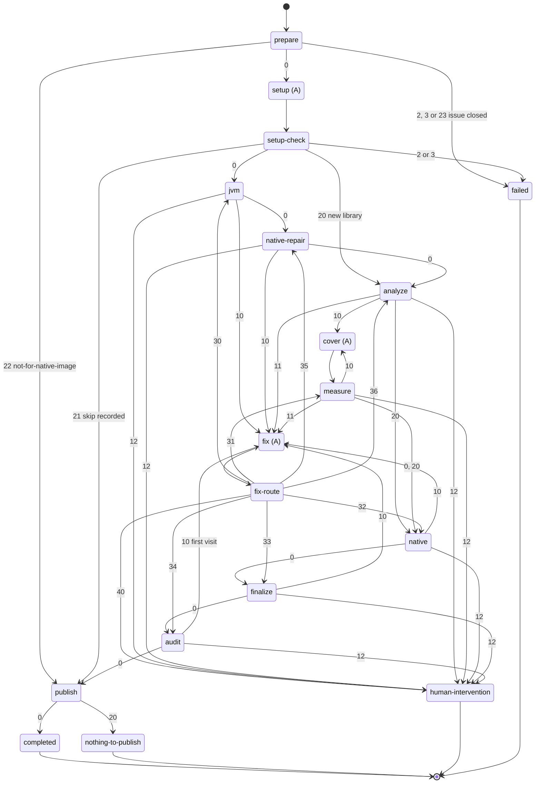

# AR-forge-workflow-pipeline: Forge workflow pipeline

One issue run is one Rhei workspace instantiated from the `forge-metadata`
template, and this declaration is the single picture of what runs between a
labeled issue and a pushed publication branch (§FS-forge-issue-resolution-goal).
Programs make every decision and agents only edit: a program's exit code is the
whole routing decision, an agent state has one outgoing edge, and no agent
report is a verdict — the program that asked for work reruns its check and
decides (§root/PRCPL-prefer-algorithmic). Every agent state starts a fresh
session. Code coverage improvement (§AR-code-coverage-improvement) is a separate
template and is not covered here.

The template lives in `forge/.agent-grounds/rhei/templates/forge-metadata/`.
Its programs are subcommands of `forge/.agent-grounds/rhei/programs/forge_run.py`,
run from the source checkout with the workspace as working directory; they sit
outside the template because Rhei renders every template file. The prompts each
agent state receives are §AR-forge-workflow-prompts.

## 1. Launcher

Moved to §AR-forge-launcher.1: the loop that claims an issue and starts its run.

## 2. Exit codes

Moved to §AR-forge-launcher.2: the exit codes by which the programs route a run.

## 3. State machine

Eleven programs, three agent states, four final states:

A cover pass costs two transitions and a fix three. In the worst case
`native` sends `native_fixes` fixes, `finalize` sends `finalize_fixes`, and
every other sender, each cover pass, and the audit one, so a run takes
`21 + 3 × (native_fixes + finalize_fixes) + 5 × explore_passes` transitions:
145 at the default 3, 5, and 20, inside the template's `transition_limit`.

## 4. Programs

| State | Does |
| --- | --- |
| `prepare` | Reads the issue, and exits `23` when it is no longer open (§FS-forge-run-requirements.2); derives the route from its label and the coordinate from its title; fetches and pins `origin/master`; spawns the worktree on its run branch (§AR-forge-workflow-pipeline.4.6), reset to the pinned base after removing any leftover worktree of an earlier run of the coordinate at its path and stopping the Gradle daemons that served it, whose in-memory build state outlives the removed files, and attaches it to the task; for a new library whose published files show it is no JVM library, writes the not-for-native-image index, validates it with `validateIndexFiles` and the pre-publication gate, checkpoints, and exits `22` (§FS-not-for-native-image-record); otherwise resolves the chunk state from the coordinate's exhaust report on the pinned base (§FS-forge-chunked-dynamic-access, §AR-dynamic-access-exhaust-report), then scaffolds a new library (a coordinate the scaffold cannot resolve is a bad input, §AR-forge-workflow-pipeline.4.1), or adds the version beside its nearest supported one, without the baseline's exhaust report (§FS-library-update-tested-version-split.3), placing and formatting its index entry as the TCK index tasks do, the latest-only fields moving with `latest` (§root/FS-metadata.1), and records the version match and the coordinate's baseline snapshot for the pull request (§AR-pr-body); stores the reporter's issue body as untrusted evidence; checkpoints; writes `run.md` |
| `setup-check` | Once, right after `setup`: the setup tail (§AR-forge-workflow-pipeline.4.1); a recorded skip exits `21`, a new library, which has no version to repair, exits `20` to `analyze`, and every other route exits `0` to `jvm` |
| `jvm` | Only for a version that already has tests: runs the version check, then `javaTest`, `codeCoverageTest` when the version has the extension suite (§AR-forge-workflow-pipeline.4.5), and `generateMetadata` (§AR-forge-workflow-pipeline.5); the first failure is one fix request for that command alone, except that a dependency no repository has, or a repository that failed, ends the run as in the setup tail (§AR-forge-workflow-pipeline.4.1) |
| `native-repair` | Right after `jvm`: runs only `test` (§AR-forge-workflow-pipeline.5); a failure is one fix request |
| `analyze` | Builds the native test image and lists the dynamic-access call sites, runs the JVM tests with JaCoCo and correlates, picks the explore mode (§AR-forge-workflow-pipeline.7), and writes the first cover prompt; a failed listing build is one fix request, after which `analyze` lists again, and a first report that fails stops the run (§AR-forge-workflow-pipeline.4.5) |
| `measure` | Reruns the JVM tests with JaCoCo and correlates against the stored call sites, with no native build; a failed report reruns each JVM suite to find the one that broke (§AR-forge-workflow-pipeline.4.5); keeps a pass that gained and resets one that did not; advances the mode and writes the next cover prompt |
| `native` | The native check over the tests exploration added: `generateMetadata`, then `test` |
| `finalize` | `splitTestOnlyMetadata`, `routeForeignMetadata`, and `checkMetadataFiles` (§AR-forge-workflow-pipeline.5), then `spotlessApply`, `spotlessCheck`, `checkstyle`, `generateLibraryStats`, the reviewer gates (§FS-local-ci-equivalent-verification.1.1), and the pre-publication gate with the coordinate's three native lanes (§AR-forge-workflow-pipeline.4.4), each once; the first failure becomes the fix request, at most `finalize_fixes` times (§AR-forge-workflow-pipeline.6) |
| `audit` | Once (§FS-local-branch-review): the first visit checkpoints and sends the audit fix request; the return visit publishes an unchanged tree, and reruns `test` and `finalize`'s lane once over a changed one, never `generateMetadata` (§AR-forge-workflow-pipeline.4.3) |
| `fix-route` | Reads the request's return code and the fix report: `cannot-fix` exits `40`, anything else the return code |
| `publish` | Commits only the coordinate's paths, a chunk's exhaust record included, and exits `20` when they are unchanged (§AR-chunked-dynamic-access-pr-linking); writes the run metrics (§FS-forge-run-metrics) and the descriptor (§AR-publication-descriptor), and pushes the publication branch `finalize` rebased; the metrics price each agent invocation at the rates of the model that ran it, count its cache writes as input, and count the worker's rounds, its cover passes plus its fix requests, as iterations; a deferred exploration opens its follow-up issue first |

### 4.1 The setup tail

`setup` may change only the coordinate entry's four URL fields in `index.json`,
the test project's `build.gradle`, and its `required-docker-images.txt`.
`setup-check`, the program that follows it, finishes the setup once: it
reverts every other edit, verifies the four URLs, downloads the main sources
into the run's source context — a failed download is retried after a pause of a
few minutes, three attempts in all — writes the user-code filter and
`allowed-packages` from the library JAR when the project has no filter yet, and
checkpoints. The filter is written without compiling or running the tests,
because the tests of a `fails-*` issue, a `fails-javac-compile` one above all,
may not build. The project already has a filter when the file its `build.gradle`
agent block names as `userCodeFilterPath`, or else `user-code-filter.json`,
exists. A missing URL is a bad input. So is a coordinate or declaration no
repository has, or one a JVM test cannot use, such as a BOM or a library
published only for a non-JVM platform: it fails identically on every retry, in
`prepare`'s scaffold as in this tail. A repository that could not be reached,
or that answered with anything but not-found, is not a bad input but an
infrastructure failure, which a later cycle retries
(§FS-forge-run-requirements.2), here and in every later Gradle build of the run,
the pre-publication gate's included: the programs' Gradle runner raises it
before any program reads the failure as a fix request, an explore mode, or a
stop (§FS-human-intervention-policy). The tail does not resolve the test
dependencies `setup` declares: on every route but a new library's, `jvm`
resolves them in `javaTest` and reports one that does not resolve as a bad
input. A new library then exits `20` to `analyze`, since it has no version to
repair; every other route exits `0` to `jvm`.

On the four `fails-*` labels `setup` may also add `skipped-versions` entries,
its unsupportable-version verdict (§FS-unsupportable-version-diagnosis.2); on
every other label the tail reverts them with the rest. Before anything else,
when the index gained an entry for the target version, the tail returns the
coordinate's paths to the pinned base, writes the entries onto the base index,
runs `validateIndexFiles` and the pre-publication gate, checkpoints, and exits
`21` to `publish`. A rejected index or an already-recorded version reverts the
entries and the tail goes on as above (§FS-unsupportable-version-diagnosis.3).

### 4.2 Call sites are listed once

The dynamic-access call sites depend only on the library JARs, which the
tracking build preserves whole, so `analyze` lists them once and keeps a copy
in the workspace, an empty one when the listing wrote none; every later
correlation passes that copy to `generateDynamicAccessCoverageReport`, which
skips the native build and runs JaCoCo (§root/AR-test-harness.8), plus the JVM
agent run when the copy lists a site that line matching cannot decide
(§root/AR-test-harness.8.1).

### 4.3 The audit

`audit` reuses `fix` unchanged: its first visit commits the tree as the audit
checkpoint, records it in the run state, and writes an ordinary fix request
whose one command is `test`, whose editable files are the test project and the
shipped metadata, and whose task is the audit of §FS-local-branch-review.2; its
return code is `34`. `fix` edits, reruns
`test`, and reports, and `fix-route` returns to `audit` or stops on
`cannot-fix` as for any sender. The return visit compares the coordinate's paths
with the checkpoint: unchanged exits `0`; changed runs `test` and then
`finalize`'s steps and gates from the program, and exits `0` on a pass or `12`
on a failure. Neither visit runs `generateMetadata`, whose merge would bring
back the agent's entries the audit corrected (§FS-local-branch-review.2). The
run state, not a Rhei visit count, records the audit, so it happens once.

### 4.4 The native lanes

`finalize` runs the pre-publication gate with the coordinate's native lanes
(§FS-local-ci-equivalent-verification.2.1), not with `reproduce_full_ci`: it
reads the pairings of mode and Java version from `ci.json` the way the
changed-metadata matrix does, and hands the gate one entry per pairing for the
run's coordinate and version. The gate runs each entry through the matrix
runner `reproduce_full_ci` also uses — `checkMetadataFiles`, then
`run-consecutive-tests.sh` under that mode and the JDK its `GRAALVM_HOME_*`
variable names — after index validation and the Docker scan. Every entry
runs: a missing JDK is an infrastructure failure, since each lane's GraalVM is
a host requirement (§FS-forge-host-requirements). The first failing entry
becomes the fix request; its command is the failing stage's
own reproduction line from `run-consecutive-tests.sh` — version and mode — with
the entry's JDK prefixed. Each Gradle call of the script is capped at five
minutes, so three lanes bound the cost that the `finalize` and `audit` program
timeouts allow for.

### 4.5 A failed coverage report

The coverage report runs every JVM suite of the version: `javaTest`, and
`codeCoverageTest` over its `code-coverage-improvement` extension suite when it
has one (§AR-code-coverage-improvement.2). A cover pass that breaks either suite
fails the report, so when the report fails `measure` reruns each suite on its
own and blames the pass for every suite that fails: one fix request names them
all and `measure` exits `11`. Only a report that fails while every suite passes
is an infrastructure failure.

`analyze`'s first report has no pass to blame: it runs the suites `jvm` has
already judged (§AR-forge-workflow-pipeline.5), or a new library's placeholder,
and a retry fails the same way, as would a basic pass, which only defers the
report to `finalize`'s `generateLibraryStats`. The run stops there with exit
`12`, quoting the report's output, unless a repository could not be reached, an
infrastructure failure a later cycle retries (§AR-forge-workflow-pipeline.4.1).

### 4.6 The run branch

The run branch is `rhei/forge-<group>-<artifact>-<version>-<id>`, `<id>` a
digest of the worktree's path. The repository's checkouts share one branch
namespace and git checks a branch out in one worktree only, so the name keeps
a run worktree of the coordinate in another checkout, stale or another
launcher's live run, from holding the branch, and `prepare` never touches it:
the leftover it removes first is the one at the worktree's own path.

## 5. The native check

`generateMetadata` runs the JVM tests under the native-image agent and merges
what the filter allows into the shipped metadata; `test` runs the coordinate's
JVM and Native Image tests as CI does — the harness has no root `nativeTest`
and no per-coordinate native-only task. The programs judge only pass or fail
and never merge, filter, or edit metadata themselves. A failure goes to `fix`
as one request, where an exact missing registration or a listed native flag is
a legal repair (§root/FS-test-contract.2.7).

A version that already has tests is checked in two states with a request each,
naming only what failed: `jvm` runs every JVM suite, then `generateMetadata`,
stopping at the first failure, and `native-repair` runs only `test`, so a fix's
metadata is tested as the fix left it. `native` runs `generateMetadata`, then
`test`, after exploration. Its failed `generateMetadata` names
`test` as a command `fix` must also pass, because `test` would judge stale
metadata and the guard (§AR-forge-workflow-pipeline.6) gives no second request
for a failure no agent was shown.

No check runs `checkMetadataFiles`: after the last regeneration, `finalize`
opens with the harness steps that follow generation, `splitTestOnlyMetadata`
and then `routeForeignMetadata`, a no-op when no condition is foreign, and the
check judges what they leave (§FS-local-ci-equivalent-verification.1). A check
that regenerated first would undo a fix's split and routing and fail again.

## 6. The loop guard

A sender records in the run state that it sent a request. When its check fails
again on its very next run, it exits `12` instead of asking again; a later,
unrelated failure is a new request. `measure` has one exception: it resets to
the last passing explore checkpoint and continues, so a cover pass that cannot
be fixed costs that pass, not the run. `finalize` has another: its lane stops
at the first failing step, so fixing one step can expose the next, and each
failure is a new request until `finalize_fixes` (default 5) are spent; a
failure after the last exits `12`. `native` has a budget too: the native
build often fails in layers — a fix to `generateMetadata` exposes a `test`
failure, a fix to some missing registrations exposes the rest — so each failure
is a new request until `native_fixes` (default 3) are spent, and its fix
reporting `cannot-fix` spends the next request instead of ending the run, the
request quoting that report. `audit` sends its request once and never asks
again: a failure after its edit exits `12`. Nothing else bounds `fix`: one
turn is bounded by its agent timeout and the run by Rhei's transition limit.

## 7. The explore decision

`analyze` decides once, over a listing, whether and how to explore. The call
sites depend only on the library JARs, so a listing build that fails says
nothing about them: a stale test, a test dependency the tracked build needs, or
a GraalVM defect can break it. `analyze` then exits `11` with one fix request
for `generateDynamicAccessReport` and its output, and `fix-route` returns to
`analyze`, which lists again; a listing that still fails after its fix exits
`12` (§AR-forge-workflow-pipeline.6). A listing build that succeeds and writes
no call sites lists no calls (§AR-forge-workflow-pipeline.4.2).

`uncovered` counts the classes with uncovered dynamic-access calls, less those
an earlier chunk processed.

| Condition | Mode | Exit |
| --- | --- | --- |
| no dynamic-access calls, new library | basic: tests of the main public API | `10` |
| no dynamic-access calls, or `uncovered` is 0, or the previous version's coverage is already met | skip, unless the reporter requested metadata, which gets one basic pass | `20` |
| `fails-*` label and `uncovered` above `defer_classes` | defer: `publish` opens the follow-up library-update issue | `20` |
| new library or update and `uncovered` above `defer_classes` | chunk: label the issue, keep an exhaust report, and spend at most `defer_classes` classes this run | as below |
| `uncovered` at least `bulk_min_classes` | bulk, then class | `10` |
| `uncovered` below `bulk_min_classes` | class only | `10` |

`measure` owns the mode and its counters. A bulk pass covers the whole report
and repeats while it gains, up to `bulk_passes`; then class mode takes one class
at a time until it is covered or has spent `class_attempts` passes, when it is
exhausted. Exploration ends when the goal is met — no actionable class left for
a new library, the previous version's coverage ratio for every other label — or
when `explore_passes` passes are spent. The previous version is the metadata
version of the index entry the run is measured against: the entry the version
was added beside, or, for a version owning its entry, that of the nearest
earlier supported version; never a tested version, which has no directories of
its own. A pass that gained nothing is reset, and the next prompt for that class
names the tests that were reset.

## 8. Agent states

| State | Target | May change | Report |
| --- | --- | --- | --- |
| `setup` | `setup_agent` | the four URL fields, `build.gradle` dependencies, `required-docker-images.txt`; on `fails-*` labels, `skipped-versions` entries | none; its edits are its result |
| `cover` | `worker_agent` | tests under the test project, its `build.gradle` and image list | `{"targets": [...]}` |
| `fix` | `worker_agent` | only the files the request lists | `{"result": "fixed" \| "cannot-fix", "changed", "summary"}` |

None has a visit budget: `measure` counts cover passes and the loop guard
bounds `fix`.

## 9. Steps Forge no longer has

The strategy registry, per-label drivers, the library-update router, the
continuation marker, the native trace gate and program-side metadata merging,
per-class native runs, the pre-push review agent (its review is now the
`audit` fix request, §FS-local-branch-review), the library preparation
preflight (its unsupportable-version verdict moved into `setup`,
§FS-unsupportable-version-diagnosis, and its not-for-native-image verdict into
`prepare`, read from the artifact's published files alone,
§FS-not-for-native-image-record), foreign-owner follow-up issues, and every per-site repair budget are gone: strategies are fixed per label, Rhei resumes a run at its
state and the run branch holds the checkpoints, and each former repair site is
one fix request. The issue-form rules, the claim, bulk-then-class exploration,
the dynamic-access report as the only oracle, the pre-publication gate, and the
trusted publisher are kept.
