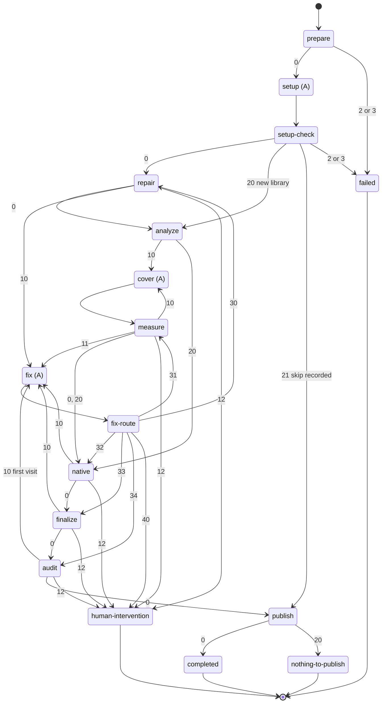

# AR-forge-workflow-pipeline: Forge workflow pipeline

One issue run is one Rhei workspace instantiated from the `forge-metadata`
template, and this declaration is the single picture of what runs between a
labeled issue and a pushed publication branch (§FS-forge-issue-resolution-goal).
Programs make every decision and agents only edit: a program's exit code is the
whole routing decision, an agent state has one outgoing edge, and no agent
report is a verdict — the program that asked for work reruns its check and
decides (§root/PRCPL-prefer-algorithmic). Every agent state starts a fresh
session. Code coverage improvement (§AR-code-coverage-improvement) is a separate
template and is not covered here.

The template lives in `forge/.agent-grounds/rhei/templates/forge-metadata/`.
Its programs are subcommands of `forge/.agent-grounds/rhei/programs/forge_run.py`,
run from the source checkout with the workspace as working directory; they sit
outside the template because Rhei renders every template file. The prompts each
agent state receives are §AR-forge-workflow-prompts.

## 1. Launcher

`forge_metadata.py` finds and claims work and starts one run; every decision
about the issue is made by `prepare` (§FS-forge-run-requirements). One cycle:

1. **Fetch.** One `gh issue list` per label and priority tier, every cycle, with
   no cache: `high-priority`, then `priority`, then the rest, oldest first,
   unassigned, excluding `not-for-native-image`. Each tier excludes the labels
   of the tiers above it, so an issue carrying both priority labels is served
   once, in its highest tier, as the repository status classifies it
   (§root/FS-repository-status-report.1). The labels are
   `library-new-request`, `library-update-request`, `fails-javac-compile`,
   `fails-java-run`, and `fails-native-image-run` (§FS-forge-scope). A fixture
   file can stand in for GitHub.
2. **Claim.** The live claimability check and the optimistic claim are the
   dispatcher's (§FS-forge-run-requirements.2): assign, wait, verify, move the
   board item to `In Progress`, release on any failure.
3. **Issue form.** The five form rules decide against the pinned base's
   `index.json`; a malformed issue gets the predefined comment and is closed
   (§FS-forge-run-requirements.3).
4. **Run.** `rhei instantiate forge-metadata` with the issue number and the two
   agent targets (§FS-forge-agent-runtime-selection), then `rhei run` with the
   dashboard. A workspace that cannot be created releases the claim. Each
   attempt at an issue has its own workspace, `runs/forge-<issue>-<attempt>`:
   an attempt whose launcher died is resumed. One that `rhei run` returned from
   is finished: a run halted short of a final state gets the infrastructure
   outcome recorded, since Rhei never re-runs a state whose attempts are spent.
   A finished attempt gives up its worktree and stays as the record, because
   Rhei keys a workspace's budget ledger by its path and refuses a new
   workspace on a used one.
5. **Close out.** The final state decides the issue's bookkeeping:
   `completed` leaves it `In Progress` for the pull request to close;
   `human-intervention` and a bad input label it `human-intervention` with the
   reason and return it to `Todo` (§FS-human-intervention-policy); an
   infrastructure failure only returns it to `Todo`.

`run-forge.sh` loops cycles until stopped, checks the host before each claim
(§FS-forge-host-requirements), and every third run, and whenever nothing can be
claimed, reviews the open Forge pull requests with the `review_agent`
(§FS-published-pr-review, §AR-forge-dispatcher-decomposition.1).

## 2. Exit codes

| Exit | Meaning |
| --- | --- |
| `0` | proceed |
| `10` | work for an agent: a cover prompt or a fix request is written |
| `11` | `measure` only: the JVM tests fail and a fix request is written |
| `12` | the check still fails right after its own fix, or after the audit's edit |
| `20` | nothing to do: a new library has no version to repair, no target, exploration deferred, explore budget spent, or nothing to publish |
| `21` | `setup-check` only: the setup verdict is recorded as a skip; go straight to `publish` |
| `2` / `3` | bad input / infrastructure or crash |
| `30`–`34` | `fix-route` only: return to `repair`, `measure`, `native`, `finalize`, `audit` |
| `40` | `fix-route` only: the fix reported that it could not help |

Every program also routes any other non-zero exit to `failed`, and every exit
writes Rhei's result file, which an edge into a final state requires; a crash,
a `SystemExit` from a shared helper included, is an infrastructure exit.

## 3. State machine

Ten programs, three agent states, four final states:

A cover pass costs two transitions and a fix three. In the worst case every
sender, each cover pass, and the audit send one fix, so a run takes
`20 + 5 × explore_passes` transitions: 120 at the default 20 passes, inside the
template's `transition_limit`.

## 4. Programs

| State | Does |
| --- | --- |
| `prepare` | Reads the issue; derives the route from its label and the coordinate from its title; fetches and pins `origin/master`; spawns the worktree on `rhei/forge-<group>-<artifact>-<version>`, reset to the pinned base after removing any leftover worktree of an earlier run of the coordinate and stopping the Gradle daemons that served it, whose in-memory build state outlives the removed files, and attaches it to the task; scaffolds a new library, or adds the version beside its nearest supported one (§FS-library-update-tested-version-split); resolves the chunk state (§FS-forge-chunked-dynamic-access); stores the reporter's issue body as untrusted evidence; checkpoints; writes `run.md` |
| `setup-check` | Once, right after `setup`: the setup tail (§AR-forge-workflow-pipeline.4.1); a recorded skip exits `21`, a new library, which has no version to repair, exits `20` to `analyze`, and every other route exits `0` to `repair` |
| `repair` | Only for a version that already has tests: runs the version check, `javaTest`, and the native check (§AR-forge-workflow-pipeline.5); a failure is one "make this version work" fix request |
| `analyze` | Once: builds the native test image and lists the dynamic-access call sites, runs the JVM tests with JaCoCo and correlates, picks the explore mode (§AR-forge-workflow-pipeline.7), and writes the first cover prompt; a listing that cannot be produced takes the basic mode instead |
| `measure` | Reruns the JVM tests with JaCoCo and correlates against the stored call sites, with no native build; keeps a pass that gained and resets one that did not; advances the mode and writes the next cover prompt |
| `native` | The native check over the tests exploration added |
| `finalize` | `spotlessApply`, then `spotlessCheck`, `checkstyle`, `generateLibraryStats`, the reviewer gates (§FS-local-ci-equivalent-verification.1.1), and the pre-publication gate with the coordinate's three native lanes (§AR-forge-workflow-pipeline.4.4), each once; the first failure becomes the fix request |
| `audit` | Once (§FS-local-branch-review): the first visit checkpoints and sends the audit fix request; the return visit publishes an unchanged tree, and reruns the native check and `finalize` once over a changed one (§AR-forge-workflow-pipeline.4.3) |
| `fix-route` | Reads the request's return code and the fix report: `cannot-fix` exits `40`, anything else the return code |
| `publish` | Commits only the coordinate's paths, writes the run metrics (§FS-forge-run-metrics), which price each agent invocation at the rates of the model that ran it and count its cache writes as input, and the descriptor (§AR-publication-descriptor), and pushes the publication branch `finalize` rebased; a deferred exploration opens its follow-up issue first |

### 4.1 The setup tail

`setup` may change only the coordinate entry's four URL fields in `index.json`,
the test project's `build.gradle`, and its `required-docker-images.txt`.
`setup-check`, the program that follows it, finishes the setup once: it
reverts every other edit, verifies the four URLs, downloads the main sources
into the run's source context — a failed download is retried after a pause of a
few minutes, three attempts in all — writes the user-code filter and
`allowed-packages` from the library JAR when the project has no filter yet, and
checkpoints. A missing URL, or a declaration that does not resolve, is a bad
input. A new library then exits `20` to `analyze`, since it has no version to
repair; every other route exits `0` to `repair`.

On the three `fails-*` labels `setup` may also add `skipped-versions` entries,
its unsupportable-version verdict (§FS-unsupportable-version-diagnosis.2); on
every other label the tail reverts them with the rest. Before anything else,
when the index gained an entry for the target version, the tail returns the
coordinate's paths to the pinned base, writes the entries onto the base index,
runs `validateIndexFiles` and the pre-publication gate, checkpoints, and exits
`21` to `publish`. A rejected index or an already-recorded version reverts the
entries and the tail goes on as above (§FS-unsupportable-version-diagnosis.3).

### 4.2 Call sites are listed once

The dynamic-access call sites depend only on the library JARs, which the
tracking build preserves whole, so `analyze` lists them once and keeps a copy
in the workspace, an empty one when the listing wrote none; every later
correlation passes that copy to `generateDynamicAccessCoverageReport` and runs
only JaCoCo (§root/AR-test-harness.8).

### 4.3 The audit

`audit` reuses `fix` unchanged: its first visit commits the tree as the audit
checkpoint, records it in the run state, and writes an ordinary fix request
whose commands are the native check and the finalization lane, whose editable
files are the test project and the shipped metadata, and whose one brief is the
audit of §FS-local-branch-review.2; its return code is `34`. `fix` edits, reruns
the commands, and reports, and `fix-route` returns to `audit` or stops on
`cannot-fix` as for any sender. The return visit compares the coordinate's paths
with the checkpoint: unchanged exits `0`; changed reruns the native check and
`finalize`'s steps and gates from the program, and exits `0` on a pass or `12`
on a failure. The run state, not a Rhei visit count, records the audit, so it
happens once.

### 4.4 The native lanes

`finalize` runs the pre-publication gate with the coordinate's native lanes
(§FS-local-ci-equivalent-verification.2.1), not with `reproduce_full_ci`: it
reads the pairings of mode and Java version from `ci.json` the way the
changed-metadata matrix does, and hands the gate one entry per pairing for the
run's coordinate and version. The gate runs each entry through the matrix
runner `reproduce_full_ci` also uses — `checkMetadataFiles`, then
`run-consecutive-tests.sh` under that mode and the JDK its `GRAALVM_HOME_*`
variable names — after index validation and the Docker scan. Every entry
runs: a missing JDK is an infrastructure failure, since each lane's GraalVM is
a host requirement (§FS-forge-host-requirements). The first failing entry
becomes the fix request; its command is the failing stage's
own reproduction line from `run-consecutive-tests.sh` — version and mode — with
the entry's JDK prefixed. Each Gradle call of the script is capped at five
minutes, so three lanes bound the cost that the `finalize` and `audit` program
timeouts allow for.

## 5. The native check

`generateMetadata` runs the JVM tests under the native-image agent and merges
what the filter allows into the shipped metadata; `checkMetadataFiles` and
`test` then run once each — the harness has no root `nativeTest`, and `test`
runs the coordinate's JVM and Native Image tests as CI does. The program judges only pass or fail and never
merges, filters, or edits metadata itself. Whatever still fails goes to `fix` as
one request with every failing output, where an exact missing registration or a
listed native flag is a legal repair (§root/FS-test-contract.2.7). A failed
`generateMetadata` stops the check, because the checks after it would judge
stale metadata; the request then names those checks as ones `fix` must also
pass, since the guard (§AR-forge-workflow-pipeline.6) gives no second request
for a failure no agent was shown. `repair`
runs the same check after `javaTest`; `native` runs it after exploration, and
it is the first native build that must pass when `analyze` could not list the
call sites.

## 6. The loop guard

A sender records in the run state that it sent a request. When its check fails
again on its very next run, it exits `12` instead of asking again; a later,
unrelated failure is a new request. `measure` has one exception: it resets to
the last passing explore checkpoint and continues, so a cover pass that cannot
be fixed costs that pass, not the run. `audit` sends its request once and
never asks again: a failure after its edit exits `12`. Nothing else bounds `fix`: one turn is
bounded by its agent timeout and the run by Rhei's transition limit.

## 7. The explore decision

`analyze` decides once whether and how to explore; `uncovered` counts the
classes with uncovered dynamic-access calls, less those an earlier chunk
processed.

| Condition | Mode | Exit |
| --- | --- | --- |
| the listing fails, because the native test image does not build yet | basic, measured by `javaTest` alone; the cause is printed as an unavailable listing, never as a library without dynamic access, whose listing succeeds and writes no call sites | `10` |
| no dynamic-access calls, new library | basic: tests of the main public API | `10` |
| no dynamic-access calls, or `uncovered` is 0, or the previous version's coverage is already met | skip, unless the reporter requested metadata, which gets one basic pass | `20` |
| `fails-*` label and `uncovered` above `defer_classes` | defer: `publish` opens the follow-up library-update issue | `20` |
| new library or update and `uncovered` above `defer_classes` | chunk: label the issue, keep an exhaust report, and spend at most `defer_classes` classes this run | as below |
| `uncovered` at least `bulk_min_classes` | bulk, then class | `10` |
| `uncovered` below `bulk_min_classes` | class only | `10` |

`measure` owns the mode and its counters. A bulk pass covers the whole report
and repeats while it gains, up to `bulk_passes`; then class mode takes one class
at a time until it is covered or has spent `class_attempts` passes, when it is
exhausted. Exploration ends when the goal is met — no actionable class left for
a new library, the previous version's coverage ratio for every other label — or
when `explore_passes` passes are spent. The previous version is the one the
index owned before this run's: the baseline the version was added beside, or,
for a version the index already lists, that entry's metadata version or the
nearest earlier supported version. A pass that gained nothing is reset, and
the next prompt for that class names the tests that were reset.

## 8. Agent states

| State | Target | May change | Report |
| --- | --- | --- | --- |
| `setup` | `setup_agent` | the four URL fields, `build.gradle` dependencies, `required-docker-images.txt`; on `fails-*` labels, `skipped-versions` entries | none; its edits are its result |
| `cover` | `worker_agent` | tests under the test project, its `build.gradle` and image list | `{"targets": [...]}` |
| `fix` | `worker_agent` | only the files the request lists | `{"result": "fixed" \| "cannot-fix", "changed", "summary"}` |

None has a visit budget: `measure` counts cover passes and the loop guard
bounds `fix`.

## 9. Steps Forge no longer has

The strategy registry, per-label drivers, the library-update router, the
continuation marker, the native trace gate and program-side metadata merging,
per-class native runs, the pre-push review agent (its review is now the
`audit` fix request, §FS-local-branch-review), the library preparation
preflight with its not-for-native-image verdict (its unsupportable-version
verdict moved into `setup`, §FS-unsupportable-version-diagnosis),
foreign-owner follow-up issues, and every per-site repair budget are gone: strategies are fixed per label, Rhei resumes a run at its
state and the run branch holds the checkpoints, and each former repair site is
one fix request. The issue-form rules, the claim, bulk-then-class exploration,
the dynamic-access report as the only oracle, the pre-publication gate, and the
trusted publisher are kept.
