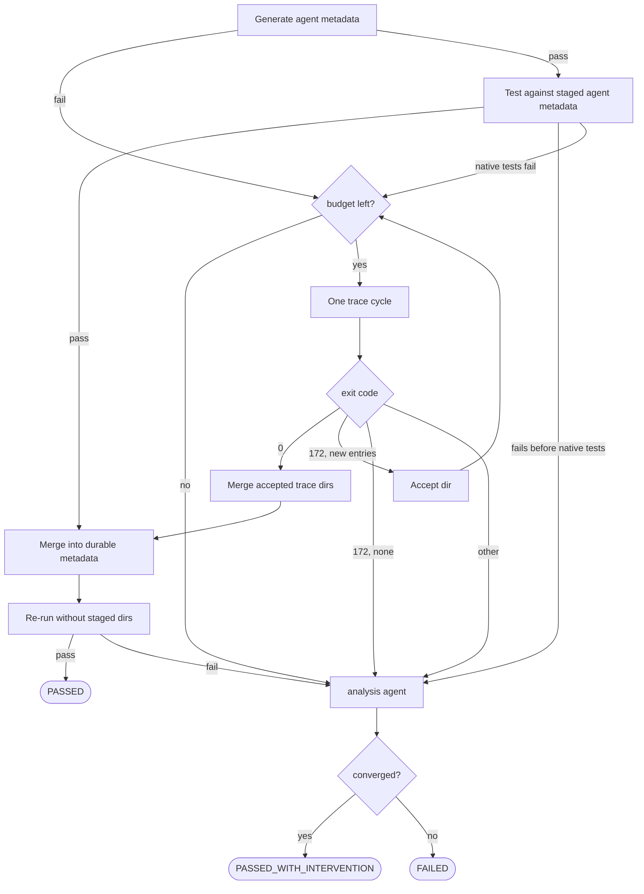

# FS-forge-publication-readiness: Publication readiness

Generation ending is not the same as a run being publishable. Everything a run
must still satisfy between a finished working tree and a merged pull request is
grounded here: the verification it must pass (§FS-local-ci-equivalent-verification),
the tested-version split its result must record
(§FS-library-update-tested-version-split), the review it receives before the
push (§FS-local-branch-review), when the result needs maintainer judgment rather
than another automated attempt (§FS-human-intervention-policy), and what Forge
does with the published PR (§FS-published-pr-review).

Publication readiness is consumed once per publication branch. After the
trusted publisher opens the matching Forge pull request, identified by the
exact head branch and publication ID, later pushes maintain that pull request;
they are not new publication attempts and must not re-enter descriptor
validation or privileged publication. This remains true when a force-pushed
rebase makes GitHub's path comparison observe publication descriptors that
arrived from the base branch. An open or merged matching Forge pull request is
a successful no-op; an ambiguous match or a matching pull request closed
without merge still fails for inspection. §GOAL-shorten-issue-to-shipped-metadata

## FS-local-ci-equivalent-verification: Local pre-publication verification

Every Forge task must pass local verification before it is allowed to produce a
PR-eligible result. Verification is split into two tiers along the boundary
between what a single-library generation can settle on its own and what it
cannot: a library-scoped tier that runs during generation and finalization
(§FS-local-ci-equivalent-verification.1), and a cross-cutting gate that runs
before publication (§FS-local-ci-equivalent-verification.2).

Local verification runs must be non-privileged in both tiers. Forge must not
invoke `sudo`, must not run scripts that invoke `sudo`, and must not prompt for
an administrator password during local automation. CI-only host mutation steps
that require elevated privileges, such as changing system Docker networking,
must be replaced by no-sudo local gates or omitted from local execution. A
command that would require `sudo` is a local verification failure, not an
interactive prompt.

Forge must record local verification commands and outcomes in run metrics and
the publication descriptor so the trusted renderer includes them in the PR
description. A task must not push a publication descriptor, mark a project item
`Done`, return `RUN_STATUS_SUCCESS`, return `SUCCESS_WITH_INTERVENTION_STATUS`,
or return `RUN_STATUS_CHUNK_READY` until both tiers have passed. If Forge cannot
complete either tier, the workflow must return `RUN_STATUS_FAILURE` and preserve
enough diagnostics for human follow-up.

### 1. Generation and finalization

Library-scoped correctness is established during generation and finalization,
because a single-library generation owns and can fully settle these checks.
Forge runs the generated tests for the coordinate under the CI native-image
surface: current GraalVM defaults and the `future-defaults-all` mode on the
latest GraalVM, plus current defaults on the GraalVM 25 toolchain (selected by
`GRAALVM_HOME_25_0`). Each native lane may run a bounded metadata/intervention
fixup and retry, so a regression that only appears under future defaults or on
GraalVM 25 is caught before publication. Finalization then validates the
coordinate's metadata with `checkMetadataFiles`, derives missing
`allowed-packages`, applies and checks style, regenerates library stats, and
rejects legacy test-only Native Image configuration: if uncommitted or changed
`META-INF/native-image` test configuration files appear under the generated test
sources, the run fails rather than publishing them, because that config form is
no longer accepted and the reachability metadata belongs in the coordinate's
`metadata/` directory. A finalization gate that fails before Gradle can create
its task — a reused daemon reporting that a build-logic class cannot be loaded
or that a task type cannot be decorated — is a stale daemon, not a metadata
verdict: Forge stops the daemons of the worktree's Gradle user home
(§FS-forge-run-requirements.4), reruns that gate exactly once, and lets only the
rerun's outcome reach metadata repair or human intervention
(§FS-human-intervention-policy).

#### 1.1 Reviewer gates

Finalization also enforces, as programs, the contribution-contract gates a
reviewer would otherwise apply by hand (§root/PRCPL-prefer-algorithmic). Each
runs after the stats are regenerated, and a failure is a fix request whose
brief names the gate, so the outcome is decided by the gate's next run and
never by the repair's account. A gate another task already enforces, such as
`checkMetadataFiles`' conditions and test-only types, is not repeated.

1. **Dynamic-access coverage.** The regenerated stats meet the label's gate of
   §root/FS-contribution-contract.3, compared with the previous version's
   stats: above 20% for a new library with calls to cover; no drop in the
   coverage ratio for a library update; the ordered repair comparison over the
   overall report and every breakdown for the `fixes-*` labels, with `N/A` as
   `0/0`; and only a nonzero covered-call count for a chunk
   (§FS-forge-chunked-dynamic-access). A breach the repair cannot close ends
   in `human-intervention`, where a maintainer weighs the explanation the
   contract allows.
2. **Reporter-requested metadata.** Every entry the reporter's issue body
   states as explicit metadata JSON — a type or a resource glob — is in the
   shipped metadata (§root/FS-test-contract.1.5). A request made only in prose
   or a stack trace cannot be checked mechanically and stays with the cover
   prompt and the audit (§FS-local-branch-review).
3. **Diff scope.** The paths publication commits stay inside the closed file
   set of §root/FS-contribution-contract.2: the coordinate's test project, its
   version's `reachability-metadata.json`, its `index.json`, and the stats,
   execution-metrics, and descriptor files of its version's stats directory.
   A legacy split-config file fails the gate wherever it appears.

### 2. Pre-publication gate

Before a task may produce a PR-eligible result, Forge must also pass a
pre-publication gate. This tier exists because the generated branch is rebased
onto the current `master` before publication, and some checks can then fail for
reasons no single-library generation could have settled: they depend on
repository state that only exists once the branch sits on top of the latest
`master`. An index-file bucket that another merged PR has since changed, a newly
flagged Docker image, or a stray edit outside the coordinate's library scope can
break the whole PR even though the generated metadata and tests are themselves
valid. The gate therefore runs exactly the post-rebase, cross-cutting checks:
index-file validation (`validateIndexFiles`, an aggregate over the rebased
`master` state), Docker-image vulnerability scanning when allowed-image files
change, and the human-intervention classification that detects changes outside
the coordinate's library scope.

The gate intentionally does not re-run the library-scoped checks that
finalization (§FS-local-ci-equivalent-verification.1) already established, and by
default it does not re-run the native test matrix or the Spring AOT smoke tests,
which the generation lanes and repository CI cover. Forge must, however, expose
an opt-in full-reproduction option (`reproduce_full_ci`) for operators and
programmatic callers that need to reproduce the expensive per-PR CI surface
locally: when enabled, the gate additionally expands the changed-metadata native
test matrix, pre-pulls Docker images for coordinates that declare them, runs the
generated tests under the CI native-image mode matrix, and runs Spring AOT smoke
verification when metadata changes affect Spring AOT projects. A
`forge-metadata` run does not enable it; its gate runs the coordinate's own
native lanes instead (§FS-local-ci-equivalent-verification.2.1).

If the gate fails, Forge must run one bounded agent repair before the run is
handed off, on the same terms as every other agent repair in the pipeline: the
agent is reached only after a check has failed, is given that check's records as
its evidence, gets one attempt, and the gate then re-runs. The repair may touch
generated library-scoped files, or shared repository files when the failure is
caused by the repository itself. The outcome is decided by the deterministic
re-run and never by the agent's account of what it repaired
(§root/PRCPL-verify-inputs); a re-run that still fails is a handoff under
§FS-human-intervention-policy. A finding from the pre-push review is not a
failed check and does not reach this repair; §FS-local-branch-review states what
answers it, and re-runs this gate when it has. After the gate passes, Forge must
algorithmically compare the final PR diff with the expected library-scoped
paths; the routed owner metadata §root/FS-contribution-contract.2 admits is
part of those paths, not a shared repository path. The verification metrics
and PR description must list any shared repository paths, and the local reviewer must treat those paths as disposition
evidence. Publication may add `human-intervention` only when the resulting
review decision is `rejected` with action `human-intervention`, following
§FS-human-intervention-policy.

#### 2.1 The coordinate's native lanes in a `forge-metadata` run

A `forge-metadata` run's finalization runs the gate with the coordinate's own
native lanes: the run's coordinate, at its own version only, in each pairing of
native-image mode and Java version that `ci.json` defines for the
changed-metadata matrix — `nativeImageModes`, restricted by
`nativeImageModeJavaVersions`. Today these are three lanes: `25` with
`current-defaults`, `latest-ea` with `current-defaults`, and `latest-ea` with
`future-defaults-all`. Other tested versions that share the metadata and the
Spring AOT smoke tests stay with repository CI. The cost is one native build per
lane.

The `25` lane is a host requirement (§FS-forge-host-requirements). The
`latest-ea` lanes run only when a usable GraalVM is installed at
`GRAALVM_HOME_LATEST_EA`; otherwise they are skipped with a log line saying so,
and their absence never fails the run. The verification record lists every
lane — coordinate, version, mode, Java version, and whether it passed, failed,
or was skipped — and the pull request description states it, so a reader knows
which lanes were verified locally.

The first failing lane is an ordinary fix request whose command reproduces
exactly that lane: the coordinate, the version, the mode, and the JDK.
Rerunning that lane is enough for the repair; the next finalization runs every
lane again, and so does the rerun after an audit edit
(§FS-local-branch-review.3).

## FS-native-test-verification-gate: Native test verification gate

Metadata production for a coordinate begins with an *approximation*. The JVM
`native-image-agent`, and any metadata an agent wrote by hand, record only the
reflection, resource, proxy, and serialization accesses observed while the test
suite runs on HotSpot. Two classes of access slip past that: accesses the suite
never exercised on HotSpot, and accesses whose reachability differs only under
closed-world native compilation. Both surface as native test failures *after*
metadata generation reported success — the agent can fail to produce the metadata
the native image actually needs.

The gate closes those gaps with **runtime truth** rather than more inference. It
runs a real native image with metadata tracing enabled, records what the
execution actually touches, and re-supplies it until the binary stops missing
metadata. It is what proves a coordinate's test binary passes on Native Image,
and the code coverage workflow ends on it (§AR-code-coverage-improvement); a
`forge-metadata` run uses its own native check (§AR-forge-workflow-pipeline.5). Native Image must always work, so `FAILED`
is a hard error: the caller returns a failure status and resets its branch to its
checkpoint.

### 1. Observe, record, rebuild

Two native-image behaviors cooperate in a single execution. **Exact reachability
metadata with exit-on-miss** makes the image treat any access not backed by
supplied metadata as a hard miss rather than silently registering it: the binary
exits `ExitStatus.MISSING_METADATA` (172) and prints the exact missing entry the
instant it hits one. **Metadata tracing support** makes that same execution write
what it observed into a per-cycle trace directory.

So one run both detects a miss and records it. Feeding that directory into the
next build makes the next cycle aware of the previously missed access. Iterating
walks the metadata from the agent's approximation to the exact set the image
requires; exit `0` means nothing missed.

Recovery is therefore ordered: **JVM agent, then native tracing, then the analysis agent.**
Tracing must not run before the agent step. Only when the loop still cannot make
the binary pass does the residual failure go to the analysis agent, because at
that point it is evidence of a code or test defect rather than a metadata gap.

### 2. Inputs and budget

The caller supplies the coordinate, the reachability repo path, and an absolute
staging root namespaced per class for the per-class caller and per coordinate
otherwise. A caller whose validation widens the coordinate's test source set —
the code coverage improvement workflow merges its dedicated coverage suite into
`test` — additionally supplies Gradle project properties, and the gate carries
them on every Gradle command it runs and on every reproduction command it hands
the analysis agent, so the repair reproduces exactly the build that failed. Agent metadata is staged under `agent` and merged trace metadata under
`trace`; durable repository metadata is written only after the final merge
succeeds and the durable re-run passes.

Condition packages, when not supplied, are derived from the coordinate's
`user-code-filter.json` after the agent step has had a chance to refresh it,
excluding obvious generated-test packages, and fall back to the coordinate's
group. They follow the library's code, not its Maven coordinate: Maven groups are
frequently not Java package roots — an `org.apache.tomcat.embed` artifact executes
`org.apache.catalina`, `org.apache.coyote`, and `org.apache.tomcat` code — and
tracing needs a condition class that is actually on the access stack before the
access occurs.

The outer budget is the caller's cycle limit, default 40. Convergence is expected within a
handful of cycles; the default is a soft cap, not a target, and each cycle
rebuilds the image, so wall-clock cost is dominated by build time. A per-cycle
timeout, default 30 minutes, caps the preflight test invocation and each trace
cycle; a timeout is treated as a non-zero exit.

### 3. The loop

The staging root and its per-cycle runs directory are reset at the start of every
invocation, so no stale entry leaks across runs.

The agent step runs first, always. If it fails, tracing starts with no accepted
trace directories. If it succeeds, the coordinate is tested against the staged
agent metadata; a failure *before* the native tests is a code or test problem and
goes straight to the analysis agent, and a native-test failure enters the trace loop.

**A pass must survive finalization.** When the coordinate passes against staged
metadata, the gate merges it into durable repository metadata and re-runs the
tests *without* staged directories. Only that durable re-run returns `PASSED`;
otherwise the finalized metadata goes to the analysis agent. This catches merge-time condition
invalidation, where raw staged metadata passes but the merged result leaves an
access behind an unsatisfied condition. A trace-backed pass takes the same route:
merge accepted trace directories, merge into durable metadata, re-run.

Each trace cycle is one Gradle invocation, rebuilding with every accepted
directory so far, and routes on the binary's exit code:

| Exit | Meaning | Action |
| --- | --- | --- |
| `0` | accumulated metadata and the code under test are sufficient | merge, finalize, return `PASSED` |
| `172`, new entries | the cycle captured a missing access | accept the directory, continue |
| `172`, no new entries | tracing stalled: the run reported a miss it did not record | open a Native Image tracing ticket, route to the analysis agent |
| other non-zero | the code is broken in a way more metadata cannot fix | route to the analysis agent |

A `172` with no new entries is a Native Image tracing defect, not a library
metadata gap — the run already proved the access happens and named it. The gate
prints accumulated progress and the failure-log tail so the defect is reproducible
upstream, then falls back so the run still makes progress.

**Inactive conditions are too-late conditions.** When GraalVM reports that
metadata for an access exists but is inactive because its runtime conditions were
not satisfied, the repair must move or duplicate that metadata under a condition
reached *before* the access — usually inferred from the library frame performing
it. Reusing the unsatisfied condition is invalid: it preserves the same timing
failure.

The result carries the status (`PASSED`, `PASSED_WITH_INTERVENTION`, or
`FAILED`), the staging root, the cycles consumed, the ordered trace directories
that produced 172, at most one intervention record, and the last relevant Gradle
log path with the binary's parsed exit code — the log path is **required** when
the status is `FAILED`, and callers surface it in run metrics and the PR body
(§FS-forge-run-metrics).

### 4. The analysis agent, and the one carve-out

The analysis agent is terminal when invoked. It has full repository write access through the
`fix-missing-reachability-metadata` skill, validates its own work, and the gate
does not re-verify or re-run a trace cycle afterwards — that would produce a
agent/verify ping-pong on a real code defect. Its exit decides between
`PASSED_WITH_INTERVENTION` and `FAILED`.

Everything reaching the analysis agent — exhausted budget (reason `metadata-gap-exhausted`),
stalled progress, trace timeouts, non-172 failures — arrives with a reproduction
command including the accepted trace directories. The agent process and its
instructions must pin the GraalVM and Java homes and the full native-image version
to the exact distribution the failed command used, and must fail rather than
reproduce or verify against a different installation. Accumulated directories are
not discarded before the analysis agent runs; its fixes are additive.

**Final merge failures are the only carve-out.** If the trace-output merge or the
final durable merge fails, the gate returns `FAILED` directly without invoking
the analysis agent. These are infrastructure problems downstream of a successful validation
path — a merge task, a filesystem write, malformed metadata input — and the analysis agent
cannot repair the metadata pipeline itself. Every other failure mode routes
through the analysis agent first.

### 5. Gradle task contract

Tracing shells out **only** to the Gradle wrapper; it must never invoke
`native-image` or `native-image-utils` directly. Rebuilding inside the loop is the
point: metadata collected by an earlier pass unlocks code paths only later builds
reach. The reachability repo must provide three tasks (§root/AR-test-harness);
which flags they pass and where they put the binary is a Gradle-side concern.

| Task | Properties | Contract |
| --- | --- | --- |
| `nativeTraceImage` | `-Pcoordinates` (required), `-PmetadataConfigDirs` (optional, → `-H:ConfigurationFileDirectories`) | Adds `-H:+MetadataTracingSupport`. Produces a binary at a path derivable from the coordinate alone. Non-zero exit is a build failure. |
| `runNativeTraceImage` | `-Pcoordinates`, `-PtraceMetadataPath` (→ `-XX:TraceMetadata=path=…`, fresh per cycle), `-PtraceMetadataConditionPackages` (→ `-XX:TraceMetadataConditionPackages`) all required; `-PmetadataConfigDirs` optional | Adds `-H:+MetadataTracingSupport` so the tracer writes at runtime, *and* `--exact-reachability-metadata` with `-H:MissingRegistrationReportingMode=Exit` so the reporter exits 172 on a miss. No caller-supplied program arguments. Runs with `ignoreExitValue=true`; the gate recovers the real code from Gradle's `finished with non-zero exit value N` line. |
| `mergeNativeTraceMetadata` | `-PinputDirs`, `-PoutputDir` (contents replaced) | Wraps `native-image-utils generate` and is the **only** point at which that tool is invoked. |

**The tracer must record whatever the reporter reports missing.** When the
reporter prints a missing entry, the same invocation must add the equivalent entry
to the directory named by `-PtraceMetadataPath`, with the metadata kind, condition
package, and target identity matching what the merge later consumes — otherwise
the loop has not produced a trustworthy runtime-observed signal and the gate falls
back rather than converging.

Toolchain configuration — GraalVM home, Java home, the native-image binary,
`native-image-utils` — is the reachability repo's responsibility; the gate does
not export, override, or check it beyond what Gradle requires. All three tasks
must accept `--no-daemon` and be idempotent across invocations on the same
coordinate, so a rerun is possible after the gate exits whatever its status.

The gate is composed from these tasks and owns no domain logic of its own. It
must not depend on any workflow implementation or on the post-generation
intervention lane, so that every caller gets identical behavior.

## FS-local-branch-review: Local pre-push audit

Before a `forge-metadata` run pushes, a local audit checks every test and
metadata change the run made against the rules a reviewer may block on
(§root/FS-contribution-contract.1), and repairs each violation it finds. A
generated contribution has no author to answer a review, so a violation the
run can still repair is repaired before the push rather than reported after it
(§root/FS-contribution-contract.5.1, §FS-forge-issue-resolution-goal).

### 1. Placement

The audit runs once, after finalization and its gates have passed
(§FS-local-ci-equivalent-verification.1) and before publication. A skip record
(§FS-unsupportable-version-diagnosis.3) ships no test or metadata and bypasses
it.

### 2. The audit is an ordinary fix request

The audit adds no agent and no instruction: it sends the run's one repair agent
an ordinary fix request. The commands are the native check and the
finalization lane, the editable files are the coordinate's test project and
shipped metadata, and the one brief is to check every change against the test
contract (§root/FS-test-contract.1, §root/FS-test-contract.2,
§root/FS-test-contract.3, §root/FS-test-contract.4), the bounds on hand-written
metadata and native flags (§root/FS-test-contract.2.7), and each cheating
pattern at the bar §root/FS-contribution-contract.4 sets for it, and fix each
violation. The brief names the patterns concretely, and three of its bars keep
the audit from rewriting tests that are fine:

1. **Only what the run changed.** Tests that an update or `fixes-*` run carried
   over unchanged from the previous version are not audited; only changed and
   added tests are (§root/FS-contribution-contract.4).
2. **The exact scaffold bar.** A test is scaffold only while its body is the
   unmodified TCK placeholder; a test is never rewritten for looking thin
   (§root/FS-contribution-contract.4.1).
3. **No depth bar without calls.** When the version reports no dynamic-access
   calls, test depth is not a violation: the audit adds or deepens no test for
   it.

### 3. No verdict

The audit records no verdict and no finding: the agent's report is evidence,
never a decision (§root/PRCPL-prefer-algorithmic). The tree decides. When the
audit left the coordinate's paths unchanged, the run publishes. When it changed
them, the native check and finalization with its gates run again, once: a pass
publishes, and a failure ends the run in `human-intervention`. A `cannot-fix`
report ends the run in `human-intervention` as any other fix does
(§FS-human-intervention-policy).

### 4. One pass

There is no second audit. The run state records that the audit was sent, so a
resumed run does not audit twice, and an audit edit that breaks a gate is not
repaired again.

## FS-human-intervention-policy: Human intervention policy

The `human-intervention` label is a maintainer follow-up signal, not a generic
failure label. Forge must apply it only when the available evidence shows that
the work cannot be safely completed or trusted without human judgment about the
generated code, repository automation, metadata, or library behavior.

A run that cannot finish — a check still failing after its fix, or a fix that
reports nothing within the rules can help — publishes nothing and labels the
issue with the reason (§AR-forge-workflow-pipeline.1). On a published pull
request the label comes from the review of §FS-published-pr-review, or from a
descriptor that still carries an older pre-push verdict of `rejected` with
action `human-intervention`; no other descriptor flag or inferred condition may
add it. Valid cases include:

- Generated tests, metadata, or workflow edits fail local verification in a way
  that points to the generated artifact or repository automation rather than a
  transient external service.
- The workflow cannot converge after its configured generation, retry, and
  recovery limits, and the saved logs point to a real library/test/metadata
  problem that needs maintainer analysis.
- Dynamic-access coverage remains missing or suspiciously low after a
  successful generation path, making the result misleading without manual
  follow-up.
- Local CI-equivalent verification passes only after shared repository files
  changed, so a maintainer must review repository-level effects before merge.
  The routed owner metadata §root/FS-contribution-contract.2 admits is not a
  shared file and does not raise this case.
- Publication detects a severe metadata, test, or coverage anomaly that makes
  the PR unsafe to auto-review as a normal generated result.
- The review of a published pull request could not fix it: the cause lies in
  a dependent library or in Native Image, a bound on reruns or fix pushes is
  spent, or the review's outcome could not be confirmed. The pull request links
  the issue that carries the diagnosis (§FS-published-pr-review.5).

Forge must not use `human-intervention` for failures that are only external or
transient infrastructure conditions. The issue-side classification is by failure
origin, not by log keywords: a workflow failure is **logical** — and gets the
label — when it comes from a run's programs or agent states, or the local
CI-equivalent verification (compile, test, native-test, and finalization gates),
which includes the rare case of an agent timeout. A workflow failure is
**external** — and must not get the label — only when it surfaces as a typed
exception from the dependency boundary Forge itself crosses: GitHub (`gh`: rate
limits and 5xx/network) as `GitHubError` / `GitHubRateLimitExceeded`, remote
git operations (push/pull/fetch/clone/ls-remote) as `GitTransportError`, and a
Gradle build that never left configuration as `GradleBootstrapFailure`. Maven
Central and Docker registry failures have no such boundary — Gradle owns them
inside `./gradlew test` and they reach Forge only as an opaque CI-check `rc != 0`,
indistinguishable from a real test failure once the in-workflow retries have run —
so they are not special-cased and fall through to the safe logical default. When a
failure is external, Forge takes no issue action: it applies no
`human-intervention` label and posts no comment, and silently releases the issue
claim (status back to `Todo`, assignees cleared) so the issue is retried later.
Rate limits and shared bootstrap failures additionally stop the current run for
a later retry. The same classification applies to every issue queue, including
the `fails-*` repair queues, and to the claim-time preconditions that run before
any workflow phase (§FS-forge-run-requirements.2).

The label can appear on issues or pull requests. On an issue, it means Forge
could not safely produce a PR-ready result and posted enough diagnostics for a
maintainer to continue. On a pull request, it means Forge produced a reviewable
artifact, but some part of the result needs explicit maintainer judgment before
normal review automation may treat it as safe. The companion
`human-intervention-fixed` PR label means a maintainer has addressed the manual
follow-up and the review of §FS-published-pr-review may resume, even on a pull
request it already labeled `reviewed`. The
resulting labeled backlog is drained by automated resolution, not per-item
manual triage. The run's worktree and branch stay on the host, so a maintainer
can continue from the last checkpoint.
