# AR-real-use-test-workflow: Real-use test generation workflow

The generation workflow of §FS-real-use-test-generation is a Rhei template at
`real-use-tests/.agent-grounds/rhei/templates/real-use-tests/`, in Rhei's
current project home (Forge's templates still use the deprecated `.agents/`).
It has the usual file set: `template.yaml`, `states.yaml`, `index.rhei.md`,
`settings.json`, `tasks/`, and a `README.md`. The programs its states run live
beside it in `.agent-grounds/rhei/programs/`, not inside it: Rhei copies and
renders every file of a template into each workspace, and the programs are run
from the source checkout instead, so a program fix reaches the next state
without re-rendering anything.

The plan is a single task that walks every state, so its priors, worktree, and
final state belong to one run. Workspaces and worktrees live under the ignored
`real-use-tests/runs/`:

```console
cd real-use-tests
rhei instantiate real-use-tests \
  --set issue_number=10900 \
  --output runs/real-use-10900
rhei run runs/real-use-10900
```

The launcher (§AR-real-use-test-launcher) does this for the next queued
issue after claiming it.

## 1. Template inputs

| Input | Default | Meaning |
| --- | --- | --- |
| `issue_number` | — | An open `real-use-test` issue whose title names the coordinate; the run resolves it. |
| `scenario_passes` | `5` | Scenario passes: the `visits` of `generate`, each adding one scenario. |
| `repo_checkout` | `../../..` | The checkout the run branches from and runs its programs from. |
| `worktree_root` | `../worktrees` | Where the run worktree is created. |
| `worker_agent` | `pi[high]:openai-codex/gpt-5.6-luna` | Agent target for the four agent states; the agent is `pi` or `claude-code`, as in `claude-code[high]:opus`. |

The coordinate is not a template input, because the template renders before
the issue is read: `prepare` reads it from the issue and writes
`runtime/real-use/run.md`, naming the coordinate, the issue, and the project
directory, and every agent state declares that file as an input and reads it
first.

## 2. State machine

```text
prepare --0--> preflight --> apply-preflight --0--> generate
generate --visitCount < visits--> generate (the next pass, a fresh session)
generate --visitCount >= visits--> native
native --0--> style-check;  --20 (no scenario)--> nothing-to-publish
native --10 (fails)--> collect-metadata                     (optional fix)
collect-metadata --0--> style-check;  --10 (still fails)--> native-agent-fix --> style-check
style-check --0--> publish;  --10 (fails)--> agent-publication-fix --> publish
style-check --20 (no scenario)--> nothing-to-publish
publish --0--> completed;  --20 (nothing changed)--> nothing-to-publish
every program --any other non-zero exit--> failed
```

The generate loop is Rhei's counted loop on `generate`: its `visits` is
`scenario_passes`, a self-loop conditioned on `visitCount < visits` starts the
next pass in a fresh agent session, and the edge conditioned on
`visitCount >= visits` leaves for `native`. The loop holds agent invocations
only: no program runs between passes, and style is checked once, by
`style-check` before publication.

The native phase runs `native` once. Its fix is optional and has no loop: only
a failure leads to `collect-metadata`, and only a failure after the collected
entries leads to `native-agent-fix`, one agent invocation bounded by
`agent_timeout: 2h`. Publication is loop-free the same way: `style-check` runs
the repository's style checks once, and only a failure leads to
`agent-publication-fix`, after which `publish` commits without checking again.
Programs keep the run state, the checkpoints and the removal record, and no
agent writes it.

### 2.1 Execution sequence

Every phase boundary is a state transition Rhei decides, from a program's exit
code or from `generate`'s visit count. Each shaded rectangle is one phase of
the task.

```mermaid
%%{init: {"themeVariables": {"noteBkgColor": "#eef2f7", "noteTextColor": "#0f172a", "noteBorderColor": "#94a3b8", "signalTextColor": "#0f172a", "signalColor": "#334155", "actorTextColor": "#0f172a", "actorBkg": "#e2e8f0", "actorBorder": "#64748b", "labelTextColor": "#0f172a", "labelBoxBkgColor": "#e2e8f0", "labelBoxBorderColor": "#64748b", "loopTextColor": "#0f172a", "sequenceNumberColor": "#ffffff"}}}%%
sequenceDiagram
    autonumber
    participant R as Rhei orchestrator
    participant P as program
    participant A as agent
    participant W as run worktree

    rect rgb(147, 197, 253)
        note over R,W: Phase prepare
        R->>P: prepare with the template inputs
        P->>W: git worktree add on rhei/real-use-artifact-version from the checkout HEAD
        opt no coordinate project yet
            P->>W: scaffoldRealUseTest, commit it as a checkpoint
        end
        P->>R: register W in runtime/worktree-refs, so every agent runs inside it
        alt inputs and worktree ready
            P-->>R: exit 0
        else bad input or infrastructure
            P-->>R: exit 2 or 3, failed
        end
    end

    rect rgb(134, 239, 172)
        note over R,W: Phase preflight
        R->>A: preflight
        A->>W: declare supporting libraries in build.gradle, images in required-docker-images.txt
        A-->>R: report written, turn ends
        R->>P: apply-preflight
        P->>W: revert every other edit, generateRealUseFilter over every declared JAR
        P->>W: commit the declarations and filter as the checkpoint
        alt libraries resolve
            P-->>R: exit 0
        else they do not
            P-->>R: exit 3, failed
        end
    end

    rect rgb(253, 186, 116)
        note over R,W: Phase generate loop
        loop generate visits, while visitCount < scenario_passes
            R->>A: generate, a fresh session per pass
            A->>W: write one scenario for a subsystem no scenario covers
            A->>W: realUseJavaTest until it passes
            A-->>R: report written, turn ends
        end
    end

    rect rgb(249, 168, 212)
        note over R,W: Phase native, its fix optional
        R->>P: native
        P->>W: realUseNativeTest, built as a consumer builds it
        alt every scenario passes
            P-->>R: exit 0, style-check
        else no scenario remains
            P-->>R: exit 20, nothing-to-publish
        else the native run fails
            P-->>R: exit 10
        end
        opt only when the native run fails
            R->>P: collect-metadata
            P->>W: realUseJavaTest with the native-image agent, output to a temp directory
            P->>W: copy the collected entries into the test-local metadata file
            P->>W: realUseNativeTest again
            alt every scenario passes
                P-->>R: exit 0, style-check
            else still fails
                P-->>R: exit 10, failure written as handoff
            end
            opt only when the native run still fails
                R->>A: native-agent-fix, at most 2 hours
                A->>W: realUseNativeTest with exact reachability until it passes
                A->>W: add test-local metadata, delete scenarios that generate bytecode
                A-->>R: report written, turn ends, style-check
            end
        end
    end

    rect rgb(203, 213, 225)
        note over R,W: Phase publish, its fix optional
        R->>P: style-check
        P->>W: spotlessCheck, checkstyle -Pcoordinates
        alt both pass
            P-->>R: exit 0, publish
        else no scenario remains
            P-->>R: exit 20, nothing-to-publish
        else a check fails
            P-->>R: exit 10, findings written as handoff
        end
        opt only when a style check fails
            R->>A: agent-publication-fix
            A->>W: add headers, reformat, fix checkstyle findings until both pass
            A-->>R: report written, turn ends, publish
        end
        R->>P: publish
        P->>W: commit the coordinate project on top of the checkpoints
        P->>W: Forge's real-use route: rebase, verify, descriptor, push
        alt pushed
            P-->>R: exit 0, completed
        else nothing changed
            P-->>R: exit 20, nothing-to-publish
        else the push failed
            P-->>R: exit 3, failed
        end
    end
```



The numbered calls collapse into five phases:

| Phase | Owner | What it establishes | Exit |
| --- | --- | --- | --- |
| Prepare | program | The attached worktree and the scaffolded project | `0`; `2`/`3` end in `failed` |
| Preflight | agent, then program | Every library and image the scenarios may use, and the filter over all their packages, fixed in a checkpoint | `0`; `3` ends in `failed` |
| Generate loop | agent | One scenario per pass, each in a fresh session | to the native phase once every pass is spent |
| Native | program; optional program and agent fix | The scenarios pass on Native Image, with shipped metadata plus, if needed, collected and agent-added test-local entries | to publish; `20` ends in `nothing-to-publish` |
| Publish | program; optional agent fix | The project passes the repository's style checks; a commit holding only the project | `0` ends in `completed`; `20` in `nothing-to-publish` |

### 2.2 The run worktree

`prepare` spawns one git worktree per coordinate, on the branch
`rhei/real-use-<artifact>-<version>` cut from the source checkout's HEAD, and
reuses it when a resumed run finds it on that branch. It then writes
`runtime/worktree-refs/<task id>.yaml` naming the worktree, which makes Rhei run
every later agent state of the task inside it; agents get absolute artifact
paths. Programs keep the workspace as their working directory and address the
worktree through the run state.

`prepare` commits the scaffold and `apply-preflight` the declarations and the
filter, each as a checkpoint on the run branch; `collect-metadata` restores the
test-local file from the latest one. `publish` adds its commit on top, so the
branch carries all three. It stages only the coordinate project, so no agent
edit elsewhere is published (§FS-real-use-test-contract.2.2).

## 3. Agent states

- `preflight` reads the target and writes only `build.gradle` and
  `required-docker-images.txt`, declaring what the coming passes may use; its
  report lists each library and image with its use
  (§FS-real-use-test-generation.2.2).
- `generate` has no handoff: each pass reads the project's existing scenarios
  itself, writes one scenario for an uncovered subsystem, runs
  `realUseJavaTest` until it passes, and reports the subsystem and class
  (§FS-real-use-test-generation.2.3).
- `native-agent-fix` receives the failure after the collected entries as a required
  handoff and has two hours: it runs the native task until it passes, edits
  only the test-local metadata file, and deletes whole the scenarios metadata
  cannot save; its report lists the entries added and each deleted scenario
  with the reason (§FS-real-use-test-generation.2.5).
- `agent-publication-fix` receives the style findings as a required handoff:
  it runs `spotlessApply`, then fixes what `spotlessCheck` and
  `checkstyle -Pcoordinates=` still report until both pass, editing only the
  coordinate project; its report lists the files it changed
  (§FS-real-use-test-generation.2.7).

All four follow the headless rules in `index.rhei.md`: every Gradle command
runs in the foreground, the report is written before the final message, and
the plan and `runtime/` files are never edited.

## 4. Program states

Every program state runs `real_use.py <state>`; its exit code is the
transition, and it writes Rhei's result file on every exit because an edge into
a final state requires one.

| State | Does | Exit |
| --- | --- | --- |
| `prepare` | Verifies the pass count and the issue (`gh issue view`: open, labeled `real-use-test`, one coordinate in the title), writes `run.md`, spawns and attaches the worktree, runs `scaffoldRealUseTest` when needed, checkpoints. | `0`, `2`, `3` |
| `apply-preflight` | Reverts edits outside the two declaration files, runs `generateRealUseFilter`, checkpoints. | `0`, `3` |
| `native` | `realUseNativeTest` once, without extra flags. | `0`, `10`, `20` |
| `collect-metadata` | Restores the test-local file to the checkpoint, runs `realUseJavaTest` with `tck.realUse.agentOutput` into a temporary directory, copies every entry that holds to §FS-real-use-tests.2.2 into the test-local file, `realUseNativeTest` again; writes the fix prompt. | `0`, `10`, `3` |
| `style-check` | `spotlessCheck` and `checkstyle -Pcoordinates=` (§AR-real-use-test-harness.2); writes the findings as the publication fix prompt. | `0`, `10`, `20`, `3` |
| `publish` | Records the native fix's deletions, commits the coordinate project, and pushes it through Forge's real-use route (§AR-real-use-test-workflow.6). | `0`, `20`, `3` |

A crash in any program exits `3`.

## 5. Run artifacts

Run state lives under `runtime/real-use/` in the Rhei workspace: `state.json`,
one report per agent invocation, the two fix prompts, the Gradle logs, and
the publication record: the description facts and the pushed branch.
Nothing under it is committed.

## 6. Publication

`publish` commits only `real-use-tests/src/<group>/<artifact>/<version>/`, in
one commit after the run's checkpoints, and writes the description facts of
§FS-real-use-test-generation.2.7 to `runtime/real-use/publication/render.json`.
It then runs Forge's `git_scripts/publish_real_use_tests.py` from the source
checkout with the worktree, the coordinate, the issue number, and the run's
start time, which with the issue is the publication's durable identity. That route
(§forge/AR-real-use-tests-publication) moves the branch to
`ai/<producer>/real-use-<artifact>-<version>-<publication id>`, rebases it onto
upstream `master`, runs the pre-publication gate, commits the descriptor
carrying the issue and the facts, and pushes; the trusted publisher renders the
description and opens the pull request
(§forge/AR-shared-publication-pipeline). The push needs the producer's `gh`
login, and a failed push ends the run in `failed`.

